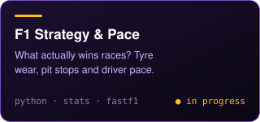
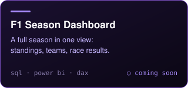
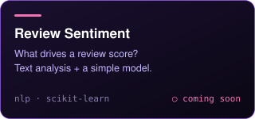

  

i started out in HR and spent way too much time automating excel files.
at some point i noticed the spreadsheets were the part of the job i actually liked,
so now i work with data full time (fmcg, mostly sql, python and databricks)
and study data science on the side.

outside of work: formula 1 every race weekend and a stack of books next to the bed.

- building an f1 race strategy analysis with fastf1
- studying for the pl-300 (power bi)
- 3rd semester of data science

  
  
  

  

  
  

